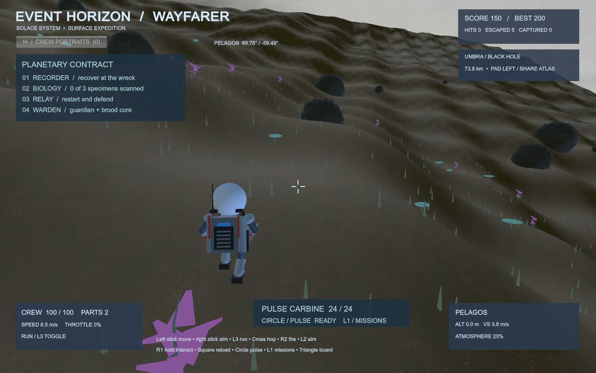

# Event Horizon / Wayfarer

A Unity space-adventure and civilization prototype with a custom C++ physics core, locally trained NPC motion predictions, whole planets, alien expeditions, a crew rover, ship design, city construction, native rocket launches, planetary wars and a Dyson collector project. Built while learning Unity and experimenting with AI-assisted development.

[](docs/media/wayfarer-animation.mp4)

**[Download the Mac game — v0.9.2](https://github.com/suryanshsoni27/event-horizon-wayfarer/releases/tag/v0.9.2)** · **[Watch the character animation demo](docs/media/wayfarer-animation.mp4)** · **[Player guide](docs/TWELVE_HORIZONS.md)**

macOS / Apple Silicon · Keyboard/mouse or DualSense · Local play with no API key

## v0.9.2: controller and campaign input repairs

Controller menus now accept the left stick as well as the D-pad, with delayed repeat. The atlas consumes its own inputs, so selecting a destination on foot cannot open civilization command or the journal. Manual thrust, braking, boost, roll, leveling or stick input takes over automatic landing. Reconnecting or resuming suppresses only controls already held, allowing other buttons to work immediately. Boarding while firing cannot carry that trigger into ship thrust.

Rebinding works in the game input loop; controller users can cancel keyboard binding with Options or Circle, and button binding by holding Options. A short Options press can still be assigned. Settings → Controller Actions includes a live device/button/stick/trigger display. Touchpad click opens the atlas, and face-flight setup is selectable from the pause menu. See the [fixes, controls and validation limits](docs/CONTROLLER_FIXES.md).

## v0.9.0: skinned characters and authored performances

The player, three companions and six armed opponent roles now share a Humanoid animation pipeline with skinned anatomy, articulated fingers, authored skin/hair assets and original curved suit armor. Blended walking, jogging and sprinting, two-handed aiming, recoil, a visible power-magazine exchange, hit reactions, landing and a full-body fall replace the earlier primitive biped motion. Driver and passenger seating uses authored clips, with weapons holstered while riding.

The carbine gains a stock, vented handguard, optic and removable cell. Native movement and combat still drive gameplay; the animation graph retargets the performances and applies contact/weapon constraints. See [the motion recording, art credits and validation](docs/CHARACTER_PERFORMANCE.md). The characters are stylized; the nine wildlife rigs and procedural environment art retain their existing designs.

## v0.8.0: inhabited worlds, forests and coasts

Some temperate destinations now contain armed astronaut enclaves and human-looking Aurelian soldiers, with infantry, marksmen and commanders. Their weapons fire native ballistic projectiles, aiming warnings give time to react, cover blocks shots, and the suit pulse interrupts bursts. Research outposts include habitats, command buildings, solar arrays and a rocket launch facility. Occupied-world missions recover security logs, decrypt archives, defend a relay and defeat the commander.

Denser broadleaf and evergreen canopies add near/far detail and native nearby trunk contacts. Temperate basins have a separate reflective water surface with animated ripples and shoreline foam. New campaigns gain sharper alpine ridges matched between the terrain mesh and C++ physics; existing saves retain their original terrain generation. The atlas marks inhabited destinations. See [player captures, how to find them, validation and production limits](docs/INHABITED_WORLDS.md).

## v0.7.0: cinematic materials and landscapes

Original generated scute, bark and leaf artwork now appears on the playable creatures and scenery. Continuous body/head surfaces, shaped armor and slimmer articulated limbs improve creature silhouettes. Rooted branching canopies, eroded desert columns and glacial formations give the three climates larger landscape forms, with native lower-trunk collisions and stable streaming. Smoother boulders, corrected leaf lighting, less repetitive ground texture and revised daylight improve the presentation.

See the [actual Unity captures, asset prompts, benchmark reports and remaining visual work](docs/CINEMATIC_ART.md). This is a substantial prototype art pass; it does not yet match the authored production quality of a large commercial game. Existing missions, nine species, campaign progress and optional face flight remain available.

## v0.6.0: planet ecology and graphics

Nine species now inhabit three climate families: canopy stalkers, fungal Sporebacks and a Thorn Matriarch on temperate worlds; scorpions, Glassbacks and a Sunbreaker on desert worlds; Rime Maws, Rimecallers and a Glacier Titan on frozen worlds. They have different anatomy, attack timing, movement, health and projectiles. The field journal identifies local fauna and explains how to fight it.

The visual pass adds curved, rooted foliage, sparse desert succulents, rigid rime formations, climate-specific minerals and nests, dry desert basins, cracked ice, improved sky scattering and more natural creature materials. URP post-processing resources are now connected, enabling the configured ACES color grading and bloom; contact occlusion adds depth at intersections. Creature spawning and checkpoint restoration also handle local rock fields more reliably. Existing mission and checkpoint progress carries forward. See the [ecology guide, screenshots and validation limits](docs/PLANET_ECOLOGY.md).

## v0.5.0: face flight

Use a live webcam preview and head movements to pilot the ship. Turn to yaw, nod to pitch and tilt to bank. Hold your mouth open to increase throttle; a broad smile cuts thrust and applies the native brake. A three-step calibration learns your neutral pose, open mouth and smile for the current session. Small head movements pass through an adjustable dead zone and smoothing filter.

Open **F7 / Settings → Face Flight**, start the camera, allow macOS camera access, follow calibration, then select **Arm / Switch to manual flight**. Look forward with a relaxed face to engage steering. **F6** stops the camera; **F8** opens recalibration. Mouse, controller stick or keyboard steering can take over. Speed and weapons can also use their usual controls. Face gestures do not fire weapons.

Camera capture is off at startup. Video, landmarks and calibration stay in memory on this Mac; the game does not record, upload or identify the face. It stops capture when the app leaves the foreground or closes. Lost/stale tracking or a second face suspends flight intent and pauses/disarms face flight. See the [face-flight guide and validation limits](docs/FACE_FLIGHT.md). Live hardware feel and an end-to-end flight with a person in front of the webcam still need manual validation; automated checks use an offline public image and injected poses.

## v0.4.0: graphics and production fixes

Terrain now stitches between detail levels, colony platforms meet graded ground, and cloud layers clear mountain peaks. Physically based ship and suit materials use licensed texture maps, an original HDR reflection environment, closed pressure hulls and beveled armor. Alien warships have their own crescent silhouette. Walk and sprint animation adds slope-aware feet and pelvis adjustment.

The fourth settings page controls anti-aliasing, bloom, field of view and shadows. Earlier preferences migrate while preserving controls, and a checkpoint created by the actual v0.3 release loads in this version. Defeat now releases the mouse and lets a controller return to save slots. See the [before/after captures, measured results and remaining production work](docs/PRODUCTION_PASS.md).

## Twelve Horizons: an expedition becomes a civilization

- **Twelve sequential chapters:** land, uncover an alien expedition, build a city, launch a survey rocket, customize a ship, settle new worlds, repel raids, fight planetary wars and confront an alien flagship. Every successive chapter increases actual enemy health and damage; later defenses add waves.
- **Real ship choices:** four original hulls, four coatings and twelve modules across propulsion, weapon, defense and cargo categories. Reactor budgets, costs and tradeoffs affect thrust, speed, hull, shields, heat, projectile behavior and cargo capacity. A live 3D preview shows your design.
- **Seven contract archetypes:** rescue, three-point survey, salvage, elite hunt, vulnerable orbital escort, intercolony courier and colony defense. The local adviser ranks jobs by your situation and explains its recommendation. Physical interactions and actual combat complete them.
- **Build and supply worlds:** eight district types, native-physics civilian shuttles, construction, shared energy, science and alloy production. Food, morale, colony policies, supply routes and timed crises give settlements needs beyond their skyline.
- **A contested frontier:** three rival civilizations develop industry, research and territory. Negotiate, fabricate reserve warships and join nearby native-physics fleet battles. Distant battles use a strategic approximation over the same health and outcome state.
- **Reach the star:** launch survey rockets through the native solver, progress through six civilization tiers and build twelve Dyson collector sectors with 672 panels. The final chapter combines three worlds, the completed project and an alien flagship battle.
- **Keep your expedition:** three independent campaign slots, checksums, atomic saves and validated backups restore the ship, crew, rover, world catalogue, mission progress, routes and civilization. Continue an existing slot or import the earlier New Dawn civilization.
- **Improve the feel:** remappable keyboard and digital controller actions, deadzone and sensitivity controls, aim assistance, toggle interaction, contrast and text-size options, three graphics presets, frame-rate targets, synthesized music and spatial sound, revised materials, stellar coronas, pooled impacts and ground dust.

The [Twelve Horizons guide](docs/TWELVE_HORIZONS.md) lists every chapter, controls, fitting rules, survival systems and checkpoint limits. [New Dawn's guide](docs/NEW_DAWN.md) explains the underlying city, shipwright, diplomacy and Dyson systems.

## Explore, land, drive

- Travel through 32 systems and 128 catalogue destinations, with additional procedural frontier systems.
- Approach black holes with a distant accretion-disk view and a nearby numerical Schwarzschild lensing shader.
- Fly among asteroids, satellites, a research station, wrecks and comet effects.
- Land on complete procedural planets, deploy six tires and drive with four astronauts aboard.
- Disembark, walk or run, fight climate-specific creatures or armed humanoids, and complete linked expedition missions.
- Reboard the parked rover, retract the tires and return to flight.
- Play using keyboard/mouse or a PS5 DualSense controller.

This remains prototype gameplay and procedural art. Detailed environment production, further character art and animation polish, a full manual campaign balance pass and broader hardware testing remain production work. Galactic distances are compressed, planets are small gameplay worlds, and vehicle/contact behavior is simplified.

## Physics and NPC architecture

**C++ simulation, C# gameplay.** A native library handles 3D Newtonian gravity, bounded thrust, atmospheric drag, terrain/boulder contact and projectile motion. Unity's C# layer handles gameplay, encounters, controls, cameras and presentation. Rover driving adds tangent traction, side grip, steering, braking, a static parking brake and terrain alignment. The solver runs in 0.01-second gameplay steps.

**A learned dynamics model.** `tools/train.py` collects 40,000 state-action transitions from the native simulator and fits a radial-feature regression model to acceleration. It evaluates an independent 8,000-transition holdout and exports weights into Unity resources. Trained weights are included, so retraining is optional.

**Prediction feeds planning.** Each space NPC has its own physical state and programmed goals. Its planner evaluates 15 candidate thrust vectors over a 2.4-second horizon, scores progress and hazards, applies the selected action, and replans. Free-space predictions use the learned model; atmosphere and terrain/contact predictions use the native solver. Larger gravity sources use normalized coordinates and force scaling.

**A separate danger learner.** A six-feature logistic model starts with 4,000 simulated projectile encounters and updates from delayed encounter outcomes during gameplay. Its risk estimates influence planning costs. Online updates change the model; they do not guarantee improved play. Surface aliens use programmed steering and attack behaviors.

The NPC architecture combines learned motion prediction with programmed planning. Black-hole gravity uses a simplified Newtonian gameplay field; the lensing shader is separate from that solver. This is not a full relativistic, N-body, aerodynamic or multi-body tire simulation.


## Build on macOS / Apple Silicon

Verified editor: **Unity 6000.6.10f1**. The native photo chooser uses macOS frameworks; other desktop platforms have not been validated.

Requirements: Unity with macOS build support, Apple Command Line Tools, CMake, and Python 3 with the packages in `requirements.txt`. FFmpeg is optional for recording tools. No API keys or `.env` file are needed.

```sh
python3 -m venv .venv
source .venv/bin/activate
python3 -m pip install -r requirements.txt
mkdir -p evidence
cmake -S native -B native/build
cmake --build native/build
```

The native build generates libraries under `UnityProject/Assets/Plugins/macOS`. Generated libraries, Unity caches and player builds are ignored by Git.

Open `UnityProject` in Unity. To create the standalone app with the verified Unity Hub installation:

```sh
'/Applications/Unity/Hub/Editor/6000.6.10f1-arm64/Unity.app/Contents/MacOS/Unity' \
  -batchmode -nographics -projectPath "$PWD/UnityProject" \
  -executeMethod BuildDemo.Build -quit \
  -logFile "$PWD/evidence/unity-build.log"
open 'Build/Event Horizon.app'
```

`BuildDemo.Build` generates the gameplay scene and builds the app. To also regenerate model weights and run the original native/training checks, use `zsh tools/build.sh` after activating the Python environment.

## Controls

Connect the DualSense through USB or [pair it with macOS Bluetooth](https://www.playstation.com/en-us/support/hardware/pair-dualsense-controller-bluetooth/). Controls held across a connection or menu transition become active after their own release; other controls remain available. The menu footer displays the detected device. **Settings → Controller Actions** shows live sticks, triggers and physical buttons. Controller disconnection and loss of game focus pause safely.

| Action | Keyboard / mouse | DualSense |
|---|---|---|
| Menu selection / confirm / pause | Arrows; Enter; Esc or F1 | Left stick or D-pad; Cross; Options |
| Save / checkpoint menu / contracts | F5 / F9 / Tab | Through pause menu |
| Flight look | Mouse / arrows | Right stick |
| Flight thrust / brake | W/S throttle; Space brake | R2 thrust; L2 brake |
| Flight strafe / vertical thrust | A/D; Z/X | Left stick |
| Roll / boost / ship weapon | Q/E; Shift; left click | L1/R1; hold Cross; Square |
| VTOL descent | K | D-pad up |
| Deploy / retract tires while stopped | 6 | D-pad down |
| Rover drive / reverse; steer | W/S; A/D | R2/L2; left stick |
| Rover handbrake / camera | Space; mouse / arrows | Cross; right stick |
| Exit / board while parked | J | Triangle |
| Walk / look | WASD; mouse / arrows | Left / right sticks |
| Run / hop | Shift or Caps Lock; Space | L3 toggle; Cross |
| Carbine fire / aim / reload | Left / right click; R | R2 / L2; Square |
| Interact / suit pulse / journal | Hold E; Q; O | Hold R1; Circle; L1 |
| Stellar atlas | M | Create / Share or touchpad click |
| Cruise | T engages / cancels | Cross in atlas; L2 cancels |
| Select black hole / orbital service | 9 / 0 | D-pad left / right |
| Salvage workshop | U; 1–4 fit | R3; D-pad selects, Cross fits |
| Session crew-photo manager | H | Native chooser uses mouse / keyboard |

In the atlas, left/right or L1/R1 changes systems, up/down selects a destination, Cross engages cruise and Circle returns. Circle also closes the journal and workshop. After defeat, restore the campaign checkpoint from the defeat screen.

Land and settle below 1.5 m/s before deploying tires or leaving the craft. The rover parks while the crew explores. Return within 6 m to board, then retract the tires before flight. Cruise requires clearing the atmosphere.

Controller tests use raw USB, full and minimal Bluetooth DualSense HID report fixtures and virtual gamepads, including real campaign menus and native rover/foot movement. They validate software routing and report decoding. A physical DualSense was not connected during this verification; USB/Bluetooth feel, connection quality and device rumble remain unverified. Basic rumble is implemented through Unity controller support; adaptive triggers and gyro controls are not implemented. Keyboard and fourteen digital controller actions can be remapped in settings; analog trigger roles remain fixed. PS and microphone buttons have no gameplay action.



## Verification

The v0.7.0 packaged player passed **519 automated checks**: 42 cinematic art, scenery and rendering, 49 ecology/rendering, 50 face-flight, 33 graphics/production, 87 campaign, 64 civilization and the original 194 checks. The original suites cover 29 gameplay, 20 crew/planet, 33 large-world, 33 surface mission, 28 space/animation and 51 controller/rover checks. Face-flight QA runs the real native detector on a public test image, checks rotation/scale-resistant gesture geometry, calibration and tracking loss, then injects poses through actual ship steering, thrust and native braking. Production and campaign suites cover terrain, graphics controls, old saves, chapter gates, physical contracts and civilization systems. Reviewed current results live in [docs/validation](docs/validation/cinematic-art-validation.json); prior results remain available there as well.

After building and closing the normal player:

```sh
python3 tools/check_cinematic_art.py
python3 tools/check_ecology.py
python3 tools/check_head_pilot.py
python3 tools/check_production.py
python3 tools/check_voyager.py
python3 tools/check_civilization.py
python3 tools/verify_game.py
python3 tools/benchmark_voyager.py
python3 tools/benchmark_voyager.py --ultra --width 1920 --height 1080
python3 tools/record_production.py
python3 tools/record_ecology.py
```

The current [cinematic art benchmark reports](docs/CINEMATIC_ART.md#validation) cover three climates and their guardian close-ups. The v0.4 [Balanced report](docs/validation/production-performance-balanced.json) and [Ultra report](docs/validation/production-performance-ultra.json) sample flight, a city, native fleet combat and the Dyson project on Apple M4 hardware with a 60 FPS target. Each records 360 frames per scene after warmup, actual resolution and render scale, anti-aliasing, frame-time percentiles, available GPU timing and Unity allocated memory. These earlier measurements do not include live camera processing. They are short staged local samples; traversal, long-term stability and other machines need separate testing. Automated progression checks do not replace a full manual balance playthrough.

The [36-second planet and creature art review](docs/media/wayfarer-planet-ecology.mp4) shows all nine species on their own surfaces at 1920×1080 and 30 FPS, with scripted cameras and staged idle/attack poses. It is silent and is not a combat playthrough or performance benchmark. See its [manifest](docs/validation/ecology-record-manifest.json).

The earlier [50-second graphics tour](docs/media/wayfarer-production-tour.mp4) shows ship designs, graded terrain, walking and sprinting, alien fleet combat, planetary atmosphere and graphics settings at 1920×1080 and 30 FPS. It uses seeded resources, scripted inputs and staged cameras, labeled on screen. Simulation advances at a fixed 1/30 second per captured frame. The original ambient score is assembled separately. It is not a performance benchmark or a live-audio recording. The [manifest](docs/validation/production-record-manifest.json) includes measured simulation timing for each segment.

The [72-second Twelve Horizons walkthrough](docs/media/twelve-horizons-tour.mp4) shows chapters, city infrastructure, native rocket ascent, ship outfitting, contracts, settings, fleet combat and the Dyson structure. Seeded resources, scripted inputs and staged cameras are labeled on screen. Capture is 1280×800 at 12 FPS, and the original ambient score is assembled separately. It is not an FPS benchmark, live-audio capture or uninterrupted manual campaign. The [manifest](docs/validation/voyager-record-manifest.json) records scene timings. Recording and QA protect normal campaign files.

Earlier showcases remain available: [1:54 New Dawn](docs/media/new-dawn-civilization-tour.mp4) and the [3:23 exploration tour](docs/media/wayfarer-full-feature-tour.mp4).

Additional native and model checks live under `tools/`. Player QA and recording commands write to the local, ignored `evidence/` directory. Reproduce the rover tour with `python3 tools/record_rover.py` and FFmpeg installed.

The original exploration tour covers atlas navigation, continuous flight and landing, tire deployment, driving and crew exploration, all linked surface missions, extraction and ascent, satellite scanning, station repair, derelicts, native projectile mining, upgrades, comets, both black-hole renderers, capture, space NPC combat, physics/model architecture and local crew portraits. Captions identify staged scenes and accelerated sections. Gameplay sources were captured at 12 fps and edited at 24 fps in a 1920×1080 layout, with an original locally synthesized ambient score. The portrait insert uses a generated synthetic robot in the current local crew manager. The cut joins separate sessions and is not an uninterrupted manual playtest.

After building, close the normal player and run `python3 tools/make_feature_tour.py --record` to capture and assemble the tour. Without `--record`, the tool reuses recordings under `evidence/`. The optional `--cosmos-record --feature-inserts` player flags stage the atlas, orbital, mining and workshop close-ups; ordinary gameplay is unchanged. Timing varies with recording conditions, so review the mission cuts after recapturing.

The included rover demo starts from a staged valid landing, uses injected gamepad input and native driving, and protects crew health after clearing the initial patrol. It demonstrates vehicle transitions rather than a physical controller playtest, an uninterrupted landing journey or an FPS benchmark. The black-hole still comes from an earlier staged rendering showcase.

## Source layout

| Path | Contents |
|---|---|
| `native/` | C++ physics, terrain/contact and macOS photo chooser |
| `UnityProject/Assets/Scripts/` | Gameplay, NPC planning, rover, controller input and procedural animation |
| `UnityProject/Assets/Resources/` | Shaders, trained model weights, world configuration and surface textures |
| `UnityProject/Assets/Editor/BuildDemo.cs` | Scene generation and macOS player build |
| `tools/` | Training, native validation, packaged QA and recording scripts |
| `docs/` | Reviewed public media and numerical results |

Surface texture credits and CC0 links are in [THIRD_PARTY_ASSETS.txt](THIRD_PARTY_ASSETS.txt). Other geometry, gameplay and procedural art are project code. See [SECURITY.md](SECURITY.md) for the boundary around credentials, local photos and developer logs.
