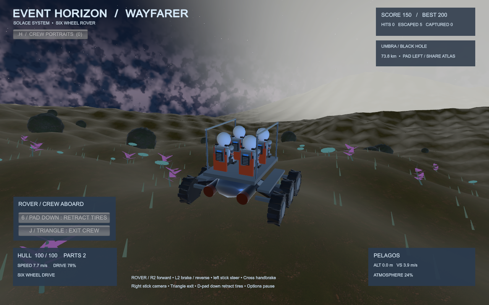

# Event Horizon / Wayfarer

A Unity space-adventure prototype with a custom C++ physics core, locally trained dynamics predictions, space NPCs, procedural planets, alien missions and a six-wheel crew rover. Built while learning Unity and experimenting with AI-assisted development.



**[Watch the 33-second rover demo](docs/media/dualsense-rover-tour.mp4)** · [Controller/rover check results](docs/validation/controller-runtime-checks.json)

## Explore, land, drive

- Travel through 32 systems and 128 catalogue destinations, with additional procedural frontier systems.
- Approach black holes with a distant accretion-disk view and a nearby numerical Schwarzschild lensing shader.
- Fly among asteroids, satellites, a research station, wrecks and comet effects.
- Land on complete procedural planets, deploy six tires and drive with four astronauts aboard.
- Disembark, walk or run, fight alien creatures, recover a recorder, scan specimens, defend a relay and defeat a guardian.
- Reboard the parked rover, retract the tires and return to flight.
- Play using keyboard/mouse or a PS5 DualSense controller.

This is prototype gameplay and procedural art. Galactic distances are compressed, planets are small gameplay worlds, and vehicle/contact behavior is simplified.

## Physics and NPC architecture

**C++ simulation, C# gameplay.** A native library handles 3D Newtonian gravity, bounded thrust, atmospheric drag, terrain/boulder contact and projectile motion. Unity's C# layer handles gameplay, encounters, controls, cameras and presentation. Rover driving adds tangent traction, side grip, steering, braking, a static parking brake and terrain alignment. The solver runs in 0.01-second gameplay steps.

**A learned dynamics model.** `tools/train.py` collects 40,000 state-action transitions from the native simulator and fits a radial-feature regression model to acceleration. It evaluates an independent 8,000-transition holdout and exports weights into Unity resources. Trained weights are included, so retraining is optional.

**Prediction feeds planning.** Each space NPC has its own physical state and programmed goals. Its planner evaluates 15 candidate thrust vectors over a 2.4-second horizon, scores progress and hazards, applies the selected action, and replans. Free-space predictions use the learned model; atmosphere and terrain/contact predictions use the native solver. Larger gravity sources use normalized coordinates and force scaling.

**A separate danger learner.** A six-feature logistic model starts with 4,000 simulated projectile encounters and updates from delayed encounter outcomes during gameplay. Its risk estimates influence planning costs. Online updates change the model; they do not guarantee improved play. Surface aliens use programmed steering and attack behaviors.

The NPC architecture combines learned motion prediction with programmed planning. Black-hole gravity uses a simplified Newtonian gameplay field; the lensing shader is separate from that solver. This is not a full relativistic, N-body, aerodynamic or multi-body tire simulation.


## Build on macOS / Apple Silicon

Verified editor: **Unity 6000.6.10f1**. The native photo chooser uses macOS frameworks; other desktop platforms have not been validated.

Requirements: Unity with macOS build support, Apple Command Line Tools, CMake, and Python 3 with the packages in `requirements.txt`. FFmpeg is optional for recording tools. No API keys or `.env` file are needed.

```sh
python3 -m venv .venv
source .venv/bin/activate
python3 -m pip install -r requirements.txt
mkdir -p evidence
cmake -S native -B native/build
cmake --build native/build
```

The native build generates libraries under `UnityProject/Assets/Plugins/macOS`. Generated libraries, Unity caches and player builds are ignored by Git.

Open `UnityProject` in Unity. To create the standalone app with the verified Unity Hub installation:

```sh
'/Applications/Unity/Hub/Editor/6000.6.10f1-arm64/Unity.app/Contents/MacOS/Unity' \
  -batchmode -nographics -projectPath "$PWD/UnityProject" \
  -executeMethod BuildDemo.Build -quit \
  -logFile "$PWD/evidence/unity-build.log"
open 'Build/Event Horizon.app'
```

`BuildDemo.Build` generates the gameplay scene and builds the app. To also regenerate model weights and run the original native/training checks, use `zsh tools/build.sh` after activating the Python environment.

## Controls

Connect the DualSense through USB or [pair it with macOS Bluetooth](https://www.playstation.com/en-us/support/hardware/pair-dualsense-controller-bluetooth/). Release all controls after connecting or resuming. The pause screen displays the detected device. Controller disconnection pauses the game.

| Action | Keyboard / mouse | DualSense |
|---|---|---|
| Start / resume; pause | Enter; Esc | Cross; Options |
| Flight look | Mouse / arrows | Right stick |
| Flight thrust / brake | W/S throttle; Space brake | R2 thrust; L2 brake |
| Flight strafe / vertical thrust | A/D; Z/X | Left stick |
| Roll / boost / ship weapon | Q/E; Shift; left click | L1/R1; hold Cross; Square |
| VTOL descent | K | D-pad up |
| Deploy / retract tires while stopped | 6 | D-pad down |
| Rover drive / reverse; steer | W/S; A/D | R2/L2; left stick |
| Rover handbrake / camera | Space; mouse / arrows | Cross; right stick |
| Exit / board while parked | J | Triangle |
| Walk / look | WASD; mouse / arrows | Left / right sticks |
| Run / hop | Shift or Caps Lock; Space | L3 toggle; Cross |
| Carbine fire / aim / reload | Left / right click; R | R2 / L2; Square |
| Interact / suit pulse / journal | Hold E; Q; O | Hold R1; Circle; L1 |
| Stellar atlas | M | Create / Share |
| Cruise | T engages / cancels | Cross in atlas; L2 cancels |
| Select black hole / orbital service | 9 / 0 | D-pad left / right |
| Salvage workshop | U; 1–4 fit | R3; D-pad selects, Cross fits |
| Session crew-photo manager | H | Native chooser uses mouse / keyboard |

In the atlas, left/right or L1/R1 changes systems, up/down selects a destination, Cross engages cruise and Circle returns. Circle also closes the journal and workshop. Cross restarts after a lost run.

Land and settle below 1.5 m/s before deploying tires or leaving the craft. The rover parks while the crew explores. Return within 6 m to board, then retract the tires before flight. Cruise requires clearing the atmosphere.

Controller tests use injected DualSense HID reports and a virtual gamepad. A physical DualSense was not connected during verification; USB/Bluetooth feel and connection quality remain unverified. Haptics, adaptive triggers and gyro controls are not implemented.


## Verification

The delivered player passed **194 packaged checks**: 29 gameplay, 20 crew/planet, 33 large-world, 33 surface mission, 28 space/animation and 51 controller/rover checks. Reviewed numerical results are included in [docs/validation](docs/validation).

After building and closing the normal player:

```sh
python3 tools/verify_game.py
python3 tools/check_rover.py
```

Additional native and model checks live under `tools/`. Player QA and recording commands write to the local, ignored `evidence/` directory. Reproduce the rover tour with `python3 tools/record_rover.py` and FFmpeg installed.

The included rover demo starts from a staged valid landing, uses injected gamepad input and native driving, and protects crew health after clearing the initial patrol. It demonstrates vehicle transitions rather than a physical controller playtest, an uninterrupted landing journey or an FPS benchmark. The black-hole still comes from an earlier staged rendering showcase.

## Source layout

| Path | Contents |
|---|---|
| `native/` | C++ physics, terrain/contact and macOS photo chooser |
| `UnityProject/Assets/Scripts/` | Gameplay, NPC planning, rover, controller input and procedural animation |
| `UnityProject/Assets/Resources/` | Shaders, trained model weights, world configuration and surface textures |
| `UnityProject/Assets/Editor/BuildDemo.cs` | Scene generation and macOS player build |
| `tools/` | Training, native validation, packaged QA and recording scripts |
| `docs/` | Reviewed public media and numerical results |

Surface texture credits and CC0 links are in [THIRD_PARTY_ASSETS.txt](THIRD_PARTY_ASSETS.txt). Other geometry, gameplay and procedural art are project code. See [SECURITY.md](SECURITY.md) for the boundary around credentials, local photos and developer logs.
