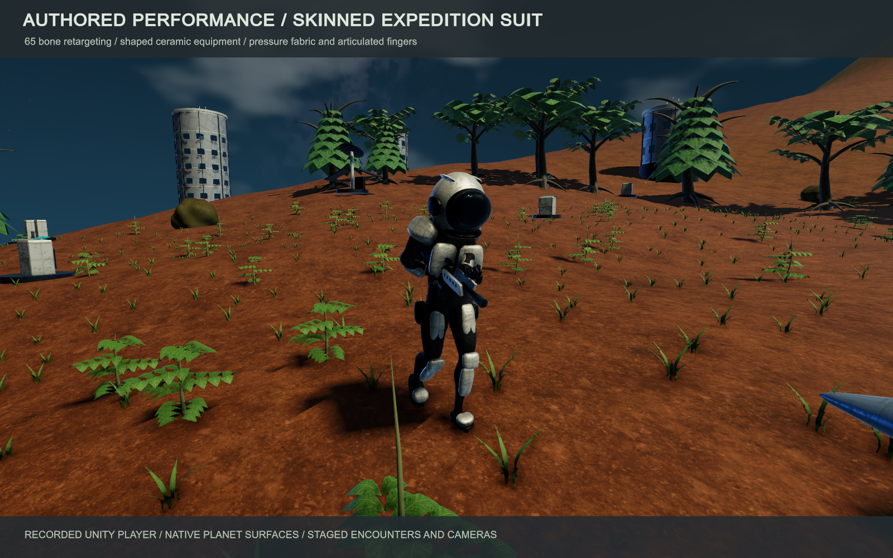

# Character performance / v0.9.0

[Watch the 42-second Unity recording](media/wayfarer-animation.mp4) · [Download the Mac build](https://github.com/suryanshsoni27/event-horizon-wayfarer/releases/tag/v0.9.0)

The playable astronaut, three rover companions and six armed opponent roles now use skinned humanoid anatomy and authored skeletal performances. This replaces v0.8's separate primitive limbs and calculated biped swings. The existing nine wildlife species retain their own procedural creature rigs.

## What changed

- Male and female anatomical meshes, skin and eye textures, rigged fingers and authored hairstyles. Pressure garments deform at shoulders, hips, elbows and knees.
- Original tapered ceramic armor with curved surfaces and returned edges, a split breastplate, utility pouches, shin protection, oxygen cylinders and a sealed panoramic helmet.
- Blended idle, walk, jog and sprint performances. Gait advances with native travel speed; acceleration and stopping blend gradually. Turning adds restrained torso banking.
- A masked upper body layer for aiming, interaction and reloads while the lower body continues moving. Spine and head follow aiming pitch; both hands follow the weapon grips.
- A rebuilt carbine with stock, action housing, vented handguard, optic, muzzle brake and removable power magazine. Reload choreography takes the support hand from the weapon to the pouch, exchanges the cell, inserts it and returns to the handguard. Shot events drive recoil.
- Authored chest/head impacts, recovery, airborne posture, landing, a full body fall and a held final death pose. Native combat damage triggers the reactions.
- Authored driver and passenger seating. Riding holsters the weapon. Existing rover controls and the local portrait roster remain available.

## How it works

`CharacterPipeline.Prepare` reproducibly imports Quaternius's free Standard character and animation packs as Unity Humanoid avatars. A `PerformanceLibrary` asset references the models, 86 imported clips and upper body mask. Fourteen clips are currently connected to gameplay: idle, walk, jog, sprint, aim, reload, interaction, airborne, landing, two impact reactions, death, driving and seated passenger poses; the idle and movement clips are shared across the roles. The complete imported library also contains optional emotes and other actions that are not assigned player controls.

`CharacterPerformance` evaluates an `AnimationMixerPlayable` and masked `AnimationLayerMixerPlayable` through a manual PlayableGraph. Locomotion blends by measured speed, and the native stepper owns the actor's position. Animation does not move the gameplay root. Authored poses drive the skin; post-pose constraints handle native ground contacts, aiming, recoil, hand grips and the visible magazine. Bone directions are preserved when solving the two-joint chains, allowing imported bind axes instead of the former assumption that every limb points straight down.

`CrewMotion` adapts the player's existing movement and rover interfaces to this graph. `HumanoidMotion` adapts opponents, and native rifle/combat events trigger reload, hit and death states. Origin shifts update planted-foot contacts. No native ABI or checkpoint schema change is required. Private helmet photos follow the animated head and retain their existing local handling.

The arm and leg geometry uses a 65-bone rig. The male model has 8,477 imported skin vertices across its body, eyes and brows, before the separate suit equipment. Armor meshes are reused; character materials are released when the character is destroyed.

## Art provenance

Base anatomy, hair, eye/skin textures and authored clips are by [Quaternius](https://quaternius.com/packs/universalanimationlibrary.html), licensed CC0. Only the free Standard editions are included. The clips are authored animations; this project does not claim a motion-capture session. Suit design, ceramic plate meshes, garment material separation, carbine details, reload choreography and runtime integration are project work. The existing credited metal and fabric maps remain in use.

See [third-party credits](../THIRD_PARTY_ASSETS.txt), the included author licenses in `Assets/Art/Quaternius`, and the [source archive/file hashes](validation/character-asset-manifest.json).

## Verification and review

Run `python3 tools/check_animation.py` after building the standalone player. The checks exercise retargeting, actual baked skin deformation, gait transitions, weapon reach, muzzle recoil, magazine extraction and restoration, gameplay hit/death events, landing, seating, origin shifts and finite bone transforms. The report is [animation-runtime-checks.json](validation/animation-runtime-checks.json). Broader campaign, controller, terrain, creature, face-flight and native regression results are in [animation-validation.json](validation/animation-validation.json).

The [video manifest](validation/animation-record-manifest.json) distinguishes staged performance scenes and cameras from the final native player walk/sprint sequence. The video is silent and is a review of actual packaged-player animation. It is not a performance benchmark or a manual campaign playthrough. Frame timing is measured separately in ordinary live encounters.

The characters remain stylized. There is no facial blendshape/lip-sync system, motion matching, physics ragdoll, multiplayer animation replication or full cinematic direction. Rigid equipment can still intersect during extreme poses, and broad hardware/manual controller testing remains outstanding. Terrain and vegetation remain the existing procedural art.

The final build averaged 59.3–59.7 FPS across six short live walking/encounter samples on an Apple M4: Balanced at 1280×800 and 90% render scale, and Ultra at 1920×1080 and 100% scale, with a 60 FPS target. Each scene used 90 warm-up and 360 sampled frames. These measurements run without video capture or encoding. See the [Balanced](validation/animation-performance-balanced.json) and [Ultra](validation/animation-performance-ultra.json) reports for frame percentiles and native encounter activity. They do not cover a long campaign or other hardware.
