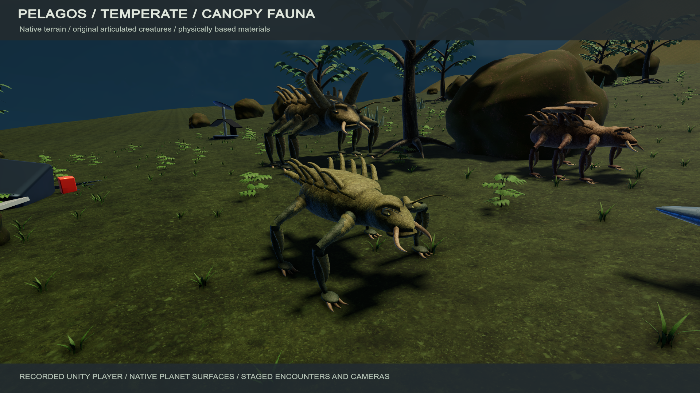
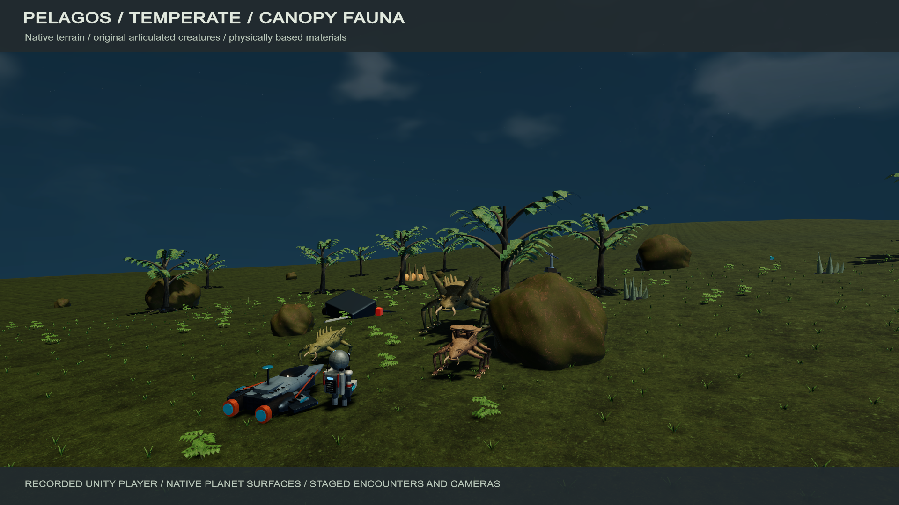
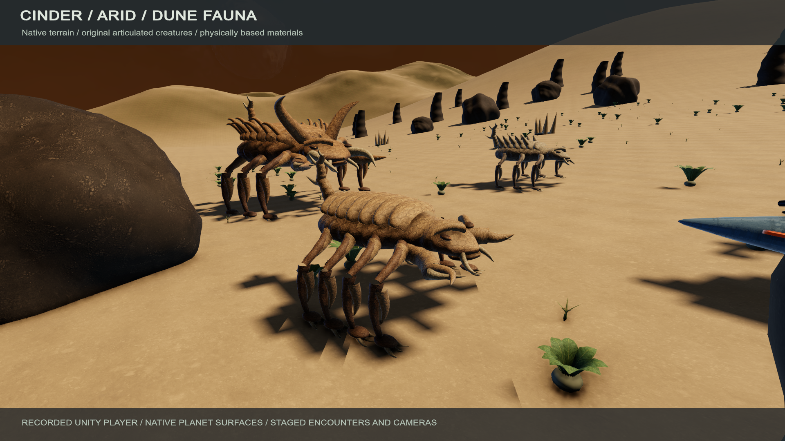
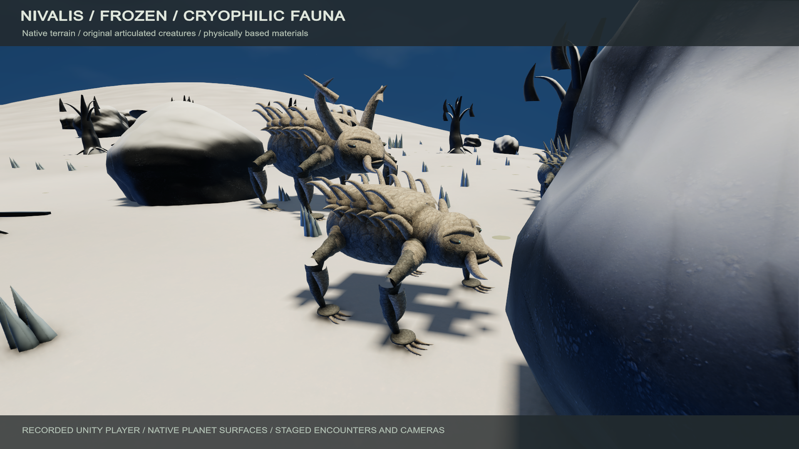

# Cinematic art pass — v0.7.0

This pass moves the playable planets toward a more detailed cinematic space-adventure style. It integrates original generated material artwork into actual 3D encounters and adds larger landscape forms. The images below are captures from the standalone Unity player.

It remains an indie prototype. It does not yet match the authored characters, animation, environments or lighting of Marvel's Guardians of the Galaxy. No art, characters or models from that game are included.

## What changed in the game

- Creature bodies and heads now share a continuous sculpted surface. Each climate has its own profile. Shallow carapace shells replace the rounded ribs, and shaped limbs replace separate oval joints. Existing articulated jaws, tails, pincers, foot placement, combat and corpse transitions still operate.
- A new UV-mapped scute albedo adds cuticle wrinkles, worn scales and small surface details. The shader adds restrained relief from the albedo gradient and varies roughness. This is generated artwork, not a scanned material or a full authored displacement/normal-map set.
- Temperate planets gain branching trees, roots and broad curved leaves with veined albedo. Leaf winding now agrees with its surface normals, improving lighting on both sides. Arid planets gain eroded mineral columns; frozen planets gain glacial branching formations. Existing ground cover and all nine species remain climate-specific.
- The larger scenery streams in stable planet-relative cells. Each local window contains at most 28 landmarks, three lower-trunk contact spheres per landmark and two render batches. These are approximate trunk/pillar collisions; fine branches and leaves have no separate collision mesh. The geometry follows floating origins and is rebuilt against the live planet after loading a checkpoint.
- Construction refreshes scenery and ground cover along with the local boulder field. The native field stays within its 192-contact limit. Boulders now use smoother, sculpted geometry with joined seam normals.
- A broader texture scale breaks up ground repetition. Temperate atmospheric color is less saturated, and the daylight key is stronger. ACES, contact occlusion, configurable shadows, SMAA and the existing reflection environment remain active.

## Original material artwork

The three PNG source images are 1254 × 1254 pixels. Unity retains their native dimensions with mipmaps, repeat wrapping and anisotropic filtering. They were made with the **built-in image generation tool**. They are used by the creature, tree and foliage renderers in the game, rather than being substituted for gameplay footage.

[Source files, exact final prompts, dimensions and SHA256 hashes](validation/cinematic-art-prompts.json).

| Material | Source | Actual use |
| --- | --- | --- |
| Weathered scutes | `xeno_scutes_v1.png` | UV-mapped creatures in all three climates |
| Fibrous bark | `alien_bark_v1.png` | Temperate trunks, branches and roots |
| Veined leaf tissue | `alien_leaf_v1.png` | Ground cover and shaped canopy leaves |

The existing Poly Haven CC0 rock, metal and fabric maps retain their attribution in [THIRD_PARTY_ASSETS.txt](../THIRD_PARTY_ASSETS.txt). The desert and frozen landmarks use the climate rock shader with those licensed rock maps.

## In-engine captures

[](media/cinematic-temperate-creature.png)

[](media/cinematic-temperate-landscape.png)

[](media/cinematic-arid-creature.png)

[](media/cinematic-frozen-creature.png)

The [48-second art review](media/wayfarer-cinematic-art.mp4) shows three landscapes and all nine species at 1920 × 1080, 30 FPS. Encounters, cameras and poses are staged and labeled. It is silent and uses fixed capture time. It is not manual gameplay or a performance benchmark. [Capture manifest](validation/cinematic-art-record-manifest.json).

## Validation

Run these against the packaged player:

```sh
python3 tools/check_cinematic_art.py
python3 tools/check_ecology.py
python3 tools/check_head_pilot.py
python3 tools/check_production.py
python3 tools/check_voyager.py
python3 tools/check_civilization.py
python3 tools/verify_game.py
python3 tools/check_native.py
```

The art suite exercises actual rendered-pixel response to material changes, connected body/head geometry, UVs and normals, visible-side scenery lighting, camera sight lines, native crew contact, camera clearance, deterministic placement, floating origins and checkpoint restoration. Earlier suites cover combat, missions, controller input, face-flight logic and the real v0.3 checkpoint migration. Results: [validation manifest](validation/cinematic-art-validation.json).

The dedicated benchmark samples all three landscapes and guardian close-ups with screen capture and camera tracking off. Each phase records 360 frames after 90 warmup frames. [Balanced](validation/cinematic-art-performance-balanced.json) and [Ultra](validation/cinematic-art-performance-ultra.json) reports record the tested settings, hardware, frame-time percentiles, available GPU timing and allocated Unity memory. Average rates across the twelve short samples were 58.7–59.7 FPS with a 60 FPS target on Apple M4. These are short stationary samples on one Mac, not traversal or long-session guarantees.

```sh
python3 tools/benchmark_cinematic_art.py
python3 tools/benchmark_cinematic_art.py --ultra --width 1920 --height 1080
python3 tools/record_cinematic_art.py
```

## Remaining visual production work

Reaching the reference game's fidelity still calls for authored hero characters and ships, production skeletons and animation clips, bespoke environment composition, a larger material library, higher-detail terrain transitions, layered weather and a complete lighting pass. Full manual campaign balance, physical DualSense feel and live face-flight validation also remain outstanding. This release improves the prototype; automated checks do not establish AAA visual quality.
