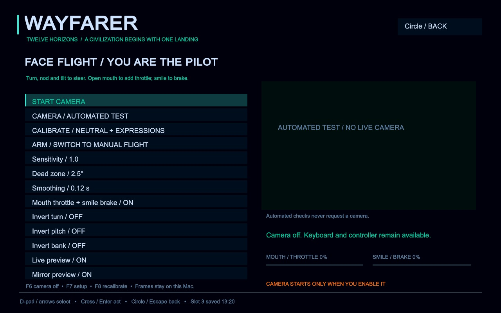

# Face flight — v0.5.0

[Download for Apple Silicon Mac](https://github.com/suryanshsoni27/event-horizon-wayfarer/releases/tag/v0.5.0) · [Campaign guide](TWELVE_HORIZONS.md)

Fly using a live camera, head movements and two deliberate mouth gestures. This experimental input mode works alongside the existing game. The camera is off when the app starts and does not automatically reopen from a save.

## Set up your camera

1. Open **F7**, or **Settings → Face Flight / Camera Setup**. The pause screen also has a Face Flight button.
2. Choose the camera row to select an available webcam. A configured, available iPhone Continuity Camera can also appear. Connect and position the camera upright in front of you.
3. Select **Start camera** and allow Event Horizon in the macOS camera prompt. If denied, enable it in **System Settings → Privacy & Security → Camera**, then retry.
4. Select **Calibrate / Neutral + expressions**. Look forward with a relaxed face and hold still for the first progress bar. Then hold your mouth open for the second step. Finally, smile broadly with your lips together for the third step. Each step waits until it sees the requested pose/expression; moving your head restarts that step's short sampling window.
5. Relax your face and select **Arm / Switch to manual flight**. This cancels VTOL/cruise assistance when resuming a flying campaign. Look forward with a relaxed mouth for a brief neutral settle before steering engages. If you are on foot or in the rover, those controls remain on keyboard/controller; face input applies only during manual ship flight.

The setup meters show mouth and smile strength after calibration so you can check both expressions before arming. Use comfortable, small movements; increase sensitivity or reduce the dead zone if needed. Per-axis inversion is available if your preferred direction differs. Preview mirroring changes the displayed picture, not steering direction.

| Input | Result |
|---|---|
| Turn head | Yaw the ship. |
| Nod up/down | Pitch the ship. |
| Tilt head side to side | Bank the ship. |
| Hold mouth open | Increase throttle while held. Returning to neutral stops increasing it and retains the current throttle. |
| Hold a broad smile | Cut throttle to zero and apply the native brake. Relax to release braking. |
| F6 | Stop the camera and clear calibration. If face flight was active, pause before returning to ordinary controls. |
| F7 | Open or close camera setup. |
| F8 | Pause into a new calibration. |
| Move mouse/stick or use keyboard steering | Disarm face steering and take over manually. |

Mouth commands must remain distinct for about 0.22 seconds. Brief mouth movements do not change throttle. Weapons retain their usual buttons. Sensitivity, dead zone, smoothing, axis inversion, camera selection and preview options are saved separately from campaign/graphics settings. Face calibration is not saved, so repeat it after restarting or changing cameras.

## Loss of tracking and camera behavior

Face input requires one clear face, a recent frame and finite head/mouth measurements. More than one face or a camera fault disarms and pauses immediately. A short tracking gap clears steering/gesture intent and engine throttle; a gap lasting about 0.35 seconds pauses and disarms. Reacquiring the face does not automatically resume an interrupted flight. Open F7 and re-arm when ready.

Menus suspend face controls. Resuming requires the neutral settle again. Camera capture stops when the app leaves the foreground or quits, and F6 is the immediate camera-off control. If no video frames arrive, the setup asks you to check and restart the camera. A normal keyboard/mouse/controller game does not require camera permission.

Video and landmarks are processed on this Mac using [AVFoundation capture](https://developer.apple.com/documentation/avfoundation/requesting-authorization-to-capture-and-save-media) and [Apple Vision head pose/landmarks](https://developer.apple.com/documentation/vision/vndetectfacelandmarksrequest). The app does not identify the person, infer emotions, request a microphone, record video or upload frames. Live frames, preview textures and calibration are held in memory and cleared when capture stops. Only input preferences go into the local `wayfarer-head-pilot-v1.json` file. Normal camera previews and user faces are excluded from automated captures/publication.

## Implementation and checks

The macOS native plugin uses a serial video-output queue and discards late frames. A revision-3 face-rectangle request provides continuous yaw/pitch/roll; the landmarks request processes that same observation for mouth measurements. Mouth opening is measured after undoing head roll. Smile width is normalized by eye separation, so tilting or moving closer does not directly imitate those commands. Both commands are calibrated against the player's neutral face and deliberate expression samples. The Unity input layer applies bounded angular rates, smoothing, dead zone and neutral gating, then sends thrust/braking through the existing C++ simulation.



**50 face-flight checks** pass in the packaged player, alongside all **378 existing checks**. The new checks cover:

- Native/managed ABI, camera permission metadata, camera-off startup and prevention of camera activation by automation.
- Actual Apple Vision detection on an unmodified public test image; blank/truncated/invalid image rejection.
- Rotation/scale-resistant mouth geometry, stable calibration, three steering axes, dead zone, inversion and bounded rates.
- Gesture holds/releases, neutral gating, missing/stale/multiple-face handling and explicit re-arming.
- Actual ship rotation, native acceleration from mouth input, native braking from a smile, idle-controller coexistence, controller takeover and real pause/pointer behavior on tracking loss.
- Preference roundtrip, clearing session calibration and preservation of normal campaign/settings files.

The test image is a public-domain NASA photograph distributed by scikit-image, with its [source and SHA-256 record](../tools/fixtures/head-pilot-astronaut-source.json). It is used offline, never as the player's identity or as a claim of live webcam capture. The [validation report](validation/head-pilot-validation.json) distinguishes these checks from a physical-camera playtest.

After building and closing the ordinary player:

```sh
python3 tools/check_head_pilot.py
python3 tools/check_production.py
python3 tools/check_voyager.py
python3 tools/check_civilization.py
python3 tools/verify_game.py
```

Live webcam latency, lighting variation, camera orientation and comfort with a person actually piloting still need manual validation. Automated pose injection and a public still-image detector check cannot establish those results. The native feature is macOS-only; the release is an ad-hoc signed Apple Silicon app without distribution signing/notarization. No PS5 console camera integration is included.
