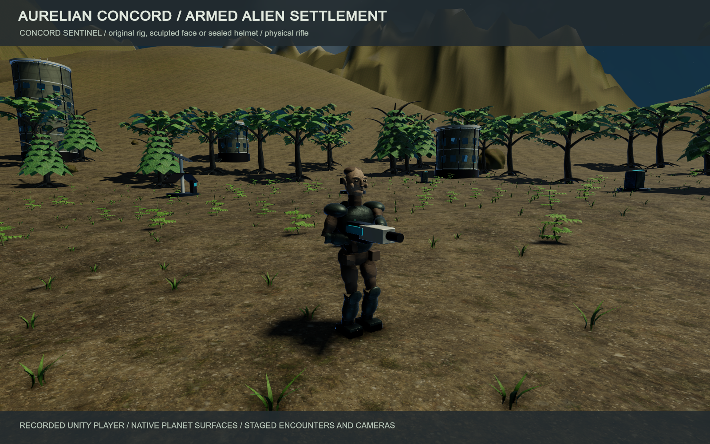
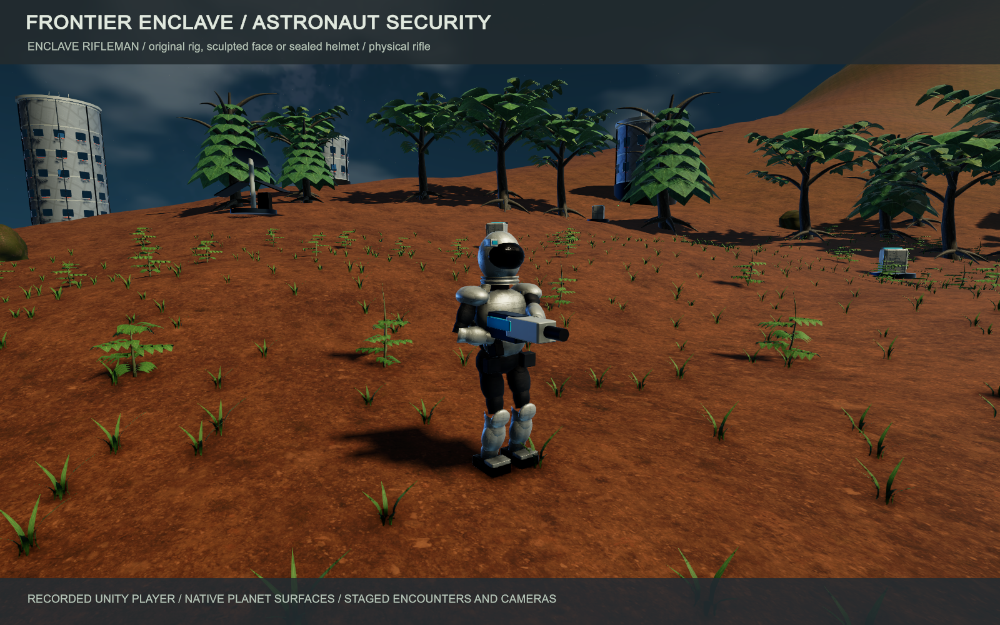
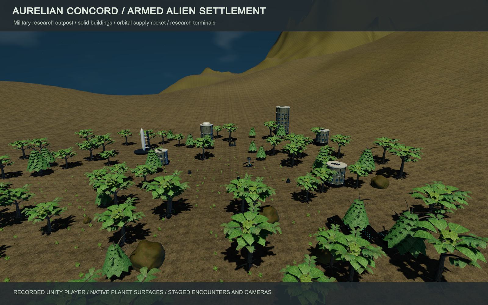
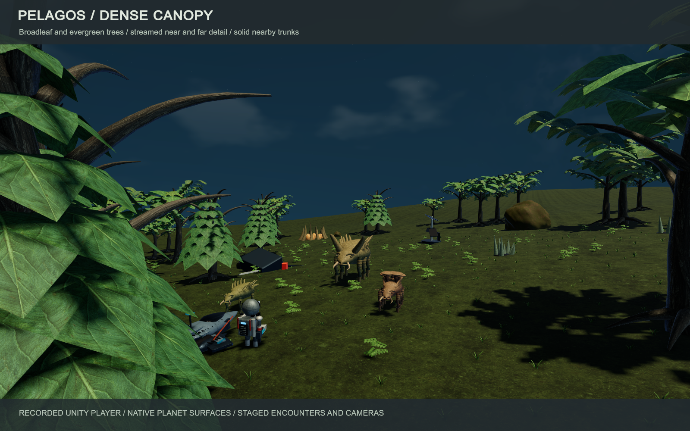
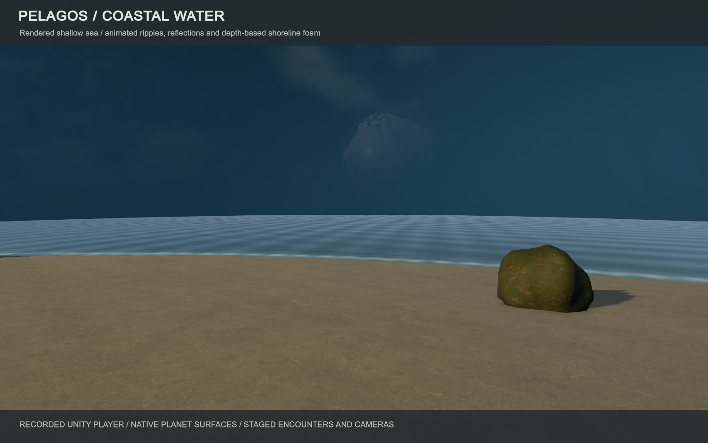
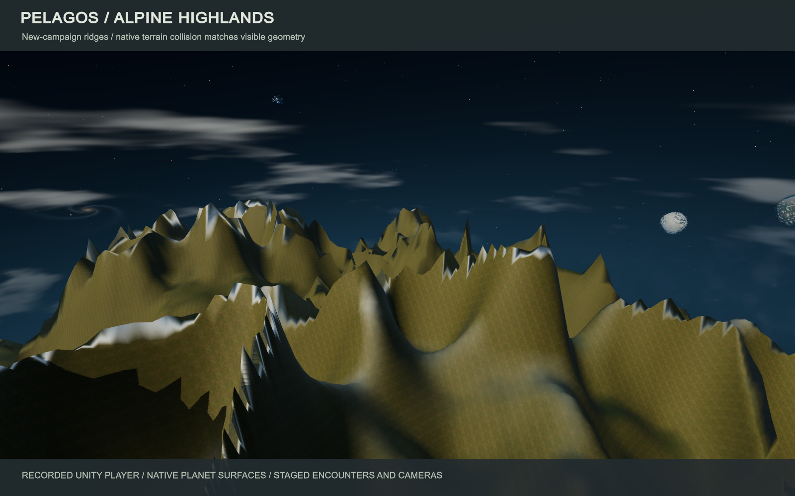

# Inhabited worlds and landscapes — v0.8.0

This release adds playable armed settlements and richer planetary scenery to the existing Unity prototype. All images and the video on this page come from the standalone player. It remains procedural prototype art; it does not match GTA VI or Guardians of the Galaxy production fidelity.

## Find the new encounters

Open the stellar atlas with **M / controller Share**. Temperate destinations marked **[INHABITED]** contain military research outposts. For example, KESTREL 1 (`S1P0`) has Aurelian Concord soldiers, and ORISON 1 (`S2P0`) has helmeted Enclave astronauts. Land, deploy the rover if desired, then disembark with **J / Triangle** to establish the expedition and its outpost. Returning to the vehicle leaves the buildings in place. Streaming the planet back in and disembarking rebuilds the outpost at the saved expedition anchor.

The Aurelian soldiers have original human-like faces and armored equipment. Enclave opponents wear sealed pressure helmets, backpacks and expedition suits. Each society has infantry, a long-range marksman and a tougher commander: six armed roles alongside the nine existing wildlife species. HOME, desert and frozen planets retain their fauna. Black-hole destinations remain black holes.

Riflemen fire three-round bursts. Marksmen use a longer aiming warning and a single stronger shot. Amber aim lines give warning before firing; buildings, nearby trunks, boulders and terrain block muzzle sight. Soldiers close distance, retreat when crowded and strafe between bursts. Physical bolts travel through the same native gravity/contact solver as other projectiles. Aim compensation accounts for gravity, but shots can be dodged. A burst is followed by a recovery/reload window. The suit pulse interrupts aiming and burst fire; player hits briefly stagger soldiers. Separate head and body hit volumes support headshot damage; controller aim assistance targets humanoid height.

These surface opponents use authored state and steering logic. They do not use the separate learned space-flight dynamics model, dialogue generation or a trained general-purpose world model.

## Settlements and missions

Each occupied expedition has five research/habitat/command buildings, an observatory dome, photovoltaic arrays, a supply rocket and service gantry. Facade bands, structural ribs, airlocks, roof equipment, recessed windows and light strips give the outpost a technological silhouette. Static geometry is combined by material into bounded render batches.

On occupied worlds the four expedition stages are security-log recovery, three archive decryptions, relay defense, then defeating the commander and recovering a command cipher. They use the existing checkpointed mission progression, rewards and extraction rules. The field journal lists the local opponents and tactics. These are hostile military outposts with sealed exterior buildings, rather than enterable cities or simulated civilian populations. Player-built cities, rockets, diplomacy and space wars continue to use the existing civilization systems.

## Trees, mountains and water

Landing areas and routes between mission sites reserve clear walking corridors through large generated props. The forest stream uses stable planet-relative candidates with broadleaf crowns and evergreen whorls. Graphics presets allow 48 / 80 / 96 landmarks in a 190 m window; geometry detail reduces for distant trees. The nearest 19 trunks have three native collision spheres each. Branches and leaves have visual geometry without individual collision. Desert and frozen scenery remains climate-specific. Boulders, near trunks and outpost envelopes share the native 192-contact budget.

New campaigns use an additional alpine ridge layer, mirrored in C# terrain rendering and C++ physics. Checkpoints now store `landscapeVersion`. Older saves omit that field, select generation zero and retain their original terrain heights and saved positions. Sharper ridges require starting a new campaign; existing colonies are not moved onto a new landscape. Stitched terrain edges now render without redundant vertical skirts that could cut across mountain valleys.

Temperate planets also have an actual separate coastal water mesh, with moving surface normals, physically based highlights, environment reflection and depth-based shoreline foam. The water sphere has sub-0.2 m chord error on the 6 km planets. Water covers the existing shallow solid basins; it is not a deep-ocean, swimming or fluid/buoyancy simulation. Arid and frozen planets keep their dry or icy basins.

## Actual player captures

[](media/inhabited-aurelian-0.png)

[](media/inhabited-astronaut-0.png)

[](media/inhabited-aurelian-outpost.png)

[](media/inhabited-forest.png)

[](media/inhabited-coast.png)

[](media/inhabited-mountains.png)

The [43-second player review](media/wayfarer-inhabited-worlds.mp4) uses staged encounters, poses and cameras, with fixed capture time at 1920 × 1080 / 30 FPS. It is silent and labeled. It is not manual gameplay or an FPS benchmark. See the [capture manifest](validation/inhabited-worlds-record-manifest.json).

## Verification and limits

The dedicated [runtime results](validation/inhabited-worlds-runtime-checks.json) exercise real burst fire and crew damage, cover cancelling attacks, pulse interruption, native building contact, animated biped legs, checkpointed identity/health/contracts, outpost reconstruction, origin shifts, rendered water pixel response and 512 native/render terrain comparisons. The [full validation manifest](validation/inhabited-worlds-validation.json) includes the earlier ecology, art, campaign, save migration, physics, controller and face-flight suites.

```sh
python3 tools/check_inhabited_worlds.py
python3 tools/check_ecology.py
python3 tools/check_cinematic_art.py
python3 tools/check_head_pilot.py
python3 tools/check_production.py
python3 tools/check_voyager.py
python3 tools/check_civilization.py
python3 tools/verify_game.py
python3 tools/check_native.py
```

The dedicated benchmark keeps walking, native movement and encounters running in a forest and both inhabited-world variants. It samples 360 frames after 90 warmup frames per scene with image capture and webcam capture off. [Balanced](validation/inhabited-worlds-performance-balanced.json) and [Ultra](validation/inhabited-worlds-performance-ultra.json) reports include hardware, settings, frame-time percentiles, memory and native/projectile activity. The six measured scenes averaged 59.3–60.0 FPS at a 60 FPS target on Apple M4 (Balanced 1280 × 800 at 90% scale; Ultra 1920 × 1080 at 100%). Each scene included roughly 10 m of crew travel, native movement and active enemies; both armed outposts fired 14 projectiles during their short runs. These are short staged traversals on one Mac, not a complete campaign playthrough or a long-session stability guarantee.

```sh
python3 tools/benchmark_inhabited_worlds.py
python3 tools/benchmark_inhabited_worlds.py --ultra --width 1920 --height 1080
python3 tools/record_inhabited_worlds.py
```

Remaining production work includes authored human characters and facial rigs, animation clips and transitions, detailed interiors, civilian routines, deeper tactical navigation, a larger environment/material library, distant terrain refinement, lighting/weather composition and a full manual balance pass. Physical DualSense feel and a live face-flight session still need manual validation. No franchise models, textures or footage are included. Existing licensed texture attribution and original generated-material provenance are retained in the [asset credits](../THIRD_PARTY_ASSETS.txt).
