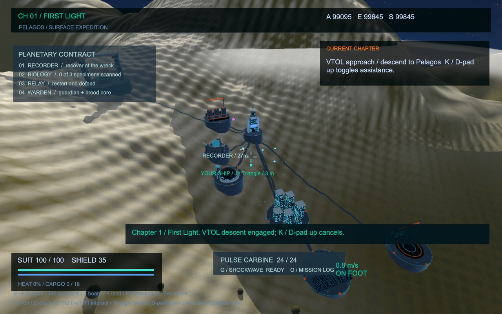
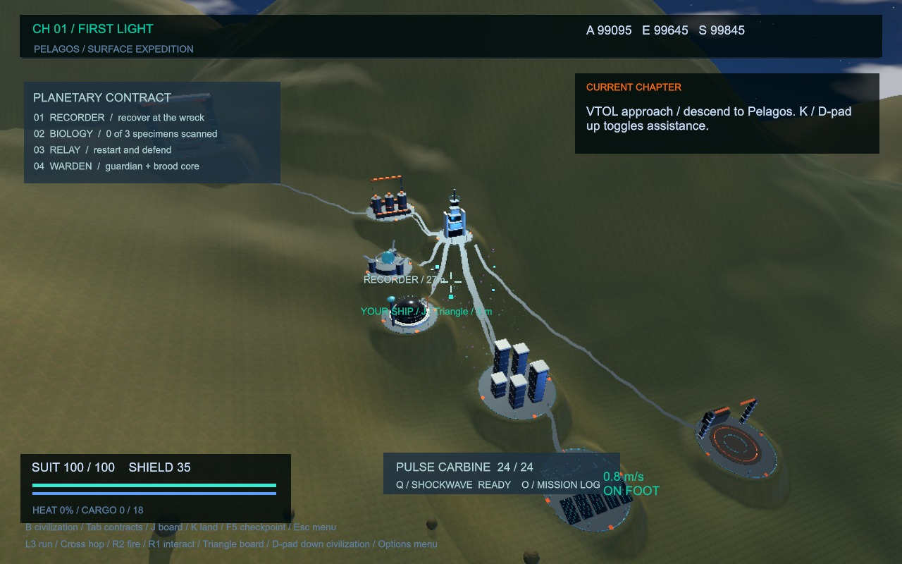
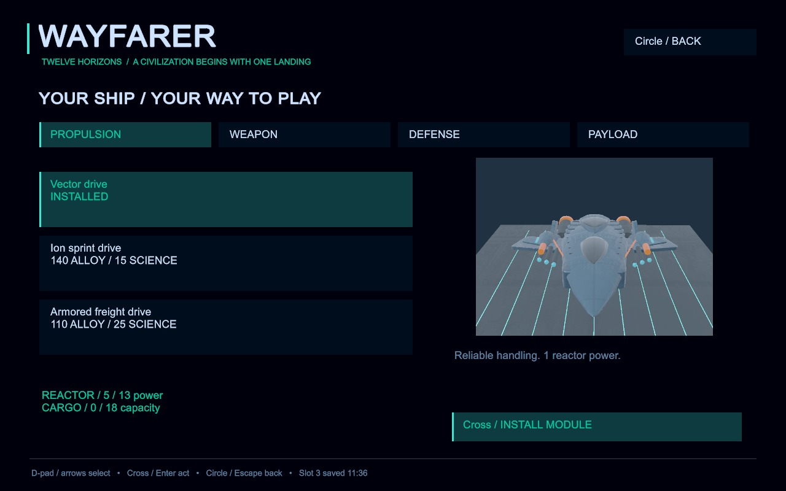
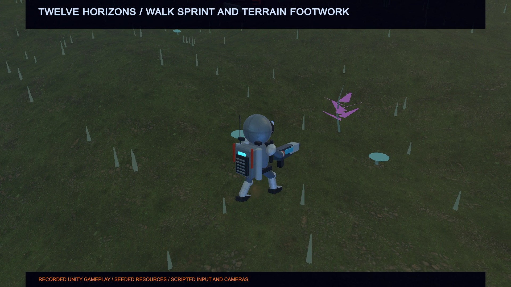

# v0.4.0 — graphics and production pass

[Download the Mac build](https://github.com/suryanshsoni27/event-horizon-wayfarer/releases/tag/v0.4.0) · [50-second graphics video](media/wayfarer-production-tour.mp4) · [Campaign guide](TWELVE_HORIZONS.md)

This release improves the existing twelve-chapter game. It retains the custom C++ simulation and local NPC planner, with new rendering, animation, graphics controls and compatibility checks. The art remains an original procedural prototype; the release does not claim finished AAA quality.

## What changed

| Area | Result |
|---|---|
| Planet terrain | Fine mesh edges follow the actual coarser edge, including cube-face boundaries. Macro shading normals reduce repeated micro-bump noise while the physical terrain height remains unchanged outside city foundations. |
| Colony foundations | Platforms meet locally graded ground with a smooth earth berm. Roads, crew and rover contacts follow the urban surface. Concealed boulders are removed from the city presentation. |
| Atmosphere | Clouds sit above the analytical mountain-height bound, removing white bands caused by cloud geometry cutting through peaks. Temperate, arid and ice worlds use distinct material palettes. |
| Ships and aliens | Closed pressure hulls, smooth beveled armor edges, revised canopies and coatings, and a separate crescent-shaped alien frigate/carrier. The flagship retains native combat behavior and its larger hit area. |
| Lighting and materials | URP physically based shading, mipmapped metal/fabric maps, depth and shadow passes, an original HDR cubemap, ambient lighting and softer particle intersections. Metal and cloth respond differently to lighting. |
| Astronaut animation | Human-paced walking, a distinct sprint cadence, slope-aware feet and pelvis adjustment keep the articulated legs within reach. Procedural aiming, reload and seated poses remain. |
| Menus and controls | Animated ship preview on the title screen, clearer save dates and a fourth graphics page. Defeat releases the pointer and supports controller navigation back to save slots. |
| Compatibility and capture | Earlier preferences migrate, an actual v0.3 checkpoint is tested, explicit launch resolutions are respected, and video frames stream into the encoder to bound disk usage. |

## Before and after

These are actual staged Unity city captures from the local pre-pass and v0.4 builds, using the same camera pose and colony layout. The comparison includes terrain shading, cloud clearance and foundation grading. UI toast timing differs. The JPEGs are format conversions of the original captures; no paint-over or generated replacement scenery is used.

| Before | v0.4 |
|---|---|
|  |  |





## Graphics controls and save compatibility

**Settings → Graphics & Camera** offers Performance/Balanced/Ultra presets, 30/60/120 FPS targets, Off/FXAA/SMAA anti-aliasing, bloom, base field of view and Off/Hard/Soft shadows. A graphics-page reset leaves custom keyboard/controller bindings intact.

Version 1 preferences migrate to payload version 2 inside the existing `wayfarer-settings-v1.json` filename and checksum envelope. Sensitivity, bindings, audio, difficulty and comfort choices are preserved. Future versions and nonfinite graphics values are rejected.

The compatibility fixture was generated by the actual v0.3.0 executable from the previously published archive, rather than by a v0.4 serializer. The current player loads it, verifies chapter and mission state plus ship/crew positions, then saves and reloads it. The fixture contains synthetic QA data. Its release, archive and fixture hashes are in [the provenance record](../tools/fixtures/v03-fixture-provenance.json).

## Validation and performance

The packaged player passes **378 checks**, including **33 new production checks** and all **345 existing checks**. [Validation summary](validation/production-validation.json) and [production check results](validation/production-runtime-checks.json).

- Maximum sampled terrain edge mismatch: **0.546 mm** across **23,940** comparisons in the staged colony scene.
- Maximum foundation surface error: **0.742 mm**, measured relative to the intended 24 cm platform lip.
- Maximum measured foot IK endpoint error: **2.07 cm** in the native walk/sprint sample. Measured speeds are 1.82 m/s walking and 5.07 m/s running on that slope; terrain affects the configured 2.35/6.4 m/s pace.
- Terrain remains within its **600-node budget** and reaches detail level 10 around the colony.

The [Balanced benchmark](validation/production-performance-balanced.json) uses 1280×800 at 90% render scale; the [Ultra benchmark](validation/production-performance-ultra.json) uses 1920×1080 at 100%. Both target 60 FPS on an Apple M4 with SMAA. Across the four scenes, Balanced averages 59.2–59.7 FPS and Ultra 59.2–59.7 FPS; p95 frame times are 17.1–17.6 ms and 17.0–17.6 ms respectively. Each scene warms up for 90 frames, then measures 360 frames with capture disabled. Reports include average, p95/p99, slowest sampled frame, GPU timing when available and Unity allocated memory. These short seeded scenes do not establish traversal performance, long-session stability or results on other hardware.

The [50-second video](media/wayfarer-production-tour.mp4) captures 1,500 frames at 1920×1080 and 30 FPS using Ultra/SMAA. Cameras, inputs and resources are staged and labeled. Each output frame advances simulation by 1/30 second; segment timing is recorded in [the manifest](validation/production-record-manifest.json). The original ambient score is synthesized separately. This capture is not a wall-clock performance measurement or a full manual campaign playthrough.

To reproduce after building and closing the ordinary player:

```sh
python3 tools/check_production.py
python3 tools/check_voyager.py
python3 tools/check_civilization.py
python3 tools/verify_game.py
python3 tools/benchmark_voyager.py
python3 tools/benchmark_voyager.py --ultra --width 1920 --height 1080
python3 tools/record_production.py
```

The QA/recording profiles are isolated under ignored `evidence/` files. They do not replace ordinary campaign slots or settings. The video encoder removes streamed PNGs as it encodes them and stops if its backlog exceeds 1 GiB.

## Assets and implementation boundaries

Six unmodified 1K maps come from [Blue Metal Plate](https://polyhaven.com/a/blue_metal_plate), [Metal Plate 02](https://polyhaven.com/a/metal_plate_02) and [Fabric Pattern 05](https://polyhaven.com/a/fabric_pattern_05), under [Poly Haven's CC0 license](https://polyhaven.com/license). Exact official URLs, byte sizes and SHA-256 hashes are in [the asset manifest](validation/production-asset-manifest.json). Geometry, cubemap generation, terrain stitching and animation are project code. No generated or purchased 3D hero asset is included.

Foundation grading is a deterministic C# surface/contact adaptation around constructed districts. The native solver still supplies the original analytical terrain and is not a general terraforming or mesh-collider engine. Distant strategic warfare remains an approximation; nearby ships and projectiles use native physics. This pass does not introduce a new trained NPC model or change those architecture claims.

## Remaining production work

| Gap | Completion criterion |
|---|---|
| Art direction and environments | Hand-author one representative planet, colony and ship interior with cohesive materials, vegetation, props, collision and several distinct points of interest; review in ordinary play. |
| Characters and animation | Replace procedural character shapes with licensed/original rigged models and authored locomotion, combat, interaction and transition animations; verify slopes, tires and weapons visually. |
| Campaign pacing | Complete a manual twelve-chapter playthrough on all three difficulty settings; tune resource rates, travel time, enemy pressure, contract repetition and rewards from observed play. |
| Performance and streaming | Profile sustained traversal, rapid origin shifts, large late-game settlements and hour-long sessions; test lower-spec hardware and memory growth. Current reports cover short staged scenes. |
| Controller feel | Test a physical DualSense over USB and Bluetooth, including reconnect, menu focus, deadzones and rumble. Current automated tests inject HID reports/virtual input. Adaptive triggers and gyro remain unsupported. |
| Distribution | Add signing/notarization and clean-machine installation tests. This release is an unsigned Apple Silicon Mac app. Other desktop builds and a PS5 console port require separate platform work. |
| Release automation | Add licensed Unity build runners, automated native/player checks and artifact signing to CI; retain explicit source/history/archive secret scans before publication. |

The public source and downloadable app are reviewed for environment files, credentials and private campaign/photo data before release. No API key or online account is needed to play.
